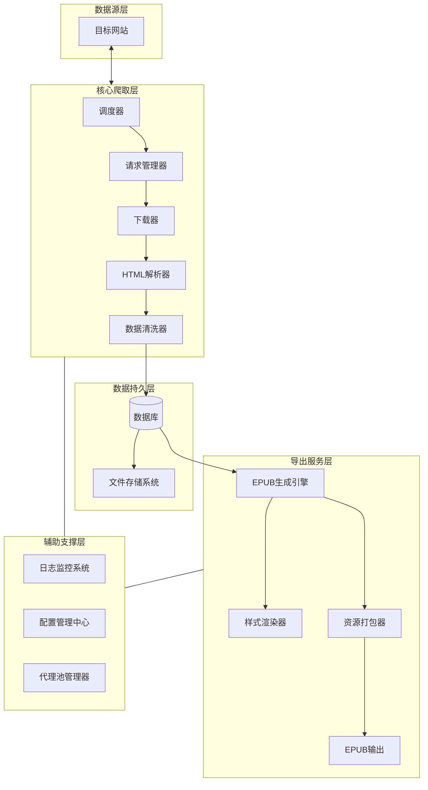
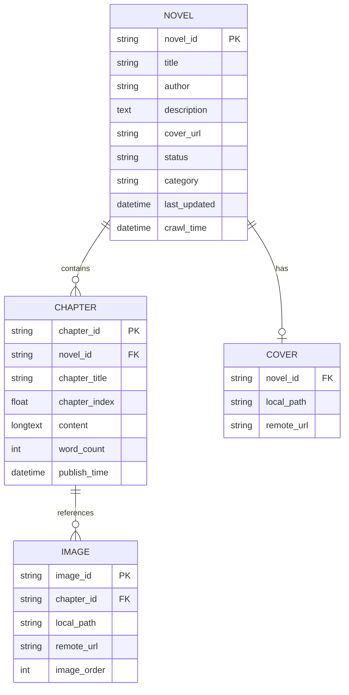
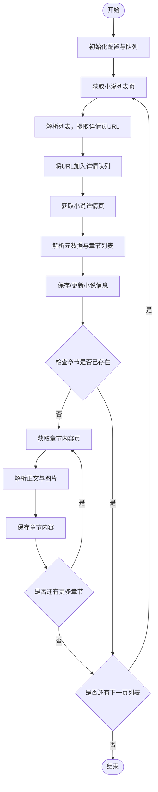
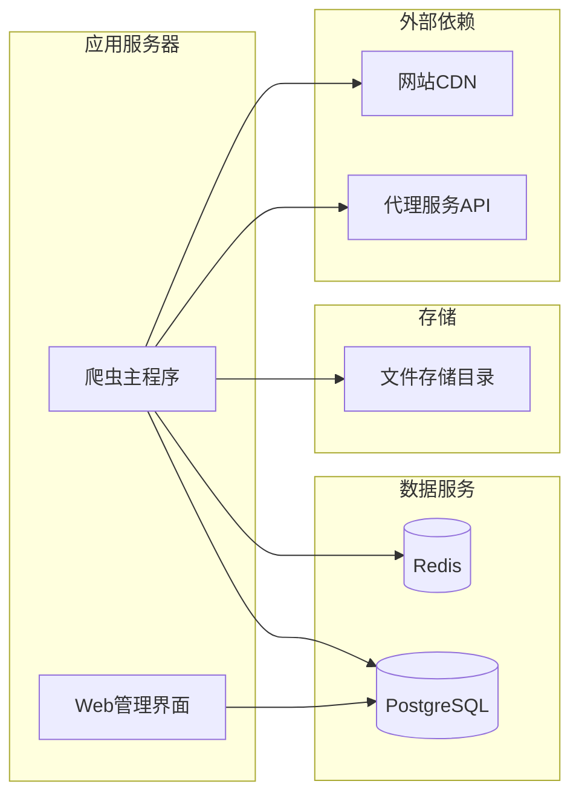

# 轻小说网站（wenku8.net 类）爬虫与EPUB导出系统 完整设计文档

**版本**：2.0  
**日期**：2026年8月13日  
**状态**：最终设计稿（不含代码实现）  

> **📜 历史设计稿**：本文是项目最早的设计方案（2026-08-13），许多设想（PostgreSQL/Redis 存储、代理池、Selenium 渲染、Web 管理界面、Docker 部署、Bloom Filter 去重、Webhook 报警）**未在 v3.0+ 实现中落地**——当前实现聚焦轻量：SQLite（WAL）+ 中间件/管道 + asyncio + 多线程 `worker_pool` + wenku8 单站 + EPUB 导出。最新且准确的资料见 `README.md`、`USAGE.md`、`TECHNICAL_DESIGN.md`（实现细节）、`MULTITHREAD_DESIGN.md`（多线程）、`WENKU8_LOGIN_REPORT.md`（登录/分桶/下架/广告修复）。本文保留作设计演进参考。

---

## 目录
1. [项目概述](#1-项目概述)
2. [系统架构设计](#2-系统架构设计)
3. [数据模型设计](#3-数据模型设计)
4. [核心模块详细设计](#4-核心模块详细设计)
5. [EPUB导出模块详细设计](#5-epub导出模块详细设计)
6. [反爬策略与请求管理](#6-反爬策略与请求管理)
7. [异常处理与监控](#7-异常处理与监控)
8. [部署与运维](#8-部署与运维)
9. [法律合规与风险控制](#9-法律合规与风险控制)
10. [附录](#10-附录)

---

## 1. 项目概述

### 1.1 项目背景
面向轻小说爱好者和个人研究者，设计一套自动化工具，用于从轻小说文库类网站（以wenku8.net为原型）稳定、高效地抓取小说数据，并将其生成为排版精美的EPUB电子书，以满足离线阅读和归档需求。

### 1.2 项目目标
- **完整性**：准确抓取小说的元信息、全部章节内容及插图资源。
- **稳定性**：具备完善的异常处理和断点续爬能力，能应对网络波动和网站结构微调。
- **美观性**：导出的EPUB电子书排版专业、视觉舒适，符合主流阅读器标准。
- **可扩展性**：系统设计模块化，支持增加新网站源或导出格式。

### 1.3 适用范围
- 个人学习、研究及合法备份。
- 不适用于大规模商业爬取或侵犯版权的行为。

---

## 2. 系统架构设计

### 2.1 整体架构图
系统采用分层模块化架构，各层职责清晰，便于维护和扩展。



### 2.2 模块职责划分
| 模块名称 | 核心职责 |
| :--- | :--- |
| **调度器** | 管理URL队列，控制爬取顺序（广度/深度），协调任务分发。 |
| **请求管理器** | 构造HTTP请求，管理请求头、Cookie，集成代理和重试策略。 |
| **下载器** | 执行网络请求，获取HTML或二进制资源（如图片）。 |
| **解析器** | 使用XPath/CSS选择器从HTML中提取结构化数据。 |
| **数据清洗器** | 清理噪声内容（广告、无关标签），标准化文本格式。 |
| **数据存储** | 将结构化数据写入数据库，将图片等文件保存至磁盘。 |
| **EPUB生成引擎** | 从数据库读取数据，生成符合EPUB 3.0标准的电子书。 |
| **样式渲染器** | 应用内置或自定义CSS，确保EPUB排版美观。 |
| **资源打包器** | 整合封面、字体、图片等资源至EPUB容器。 |
| **代理池管理器** | 维护可用代理列表，在请求失败时切换IP。 |
| **日志监控系统** | 记录全流程日志，提供实时状态监控和错误报警。 |
| **配置管理中心** | 集中管理爬取规则、导出配置、反爬参数等。 |

---

## 3. 数据模型设计

### 3.1 核心实体关系图（ER）


### 3.2 数据字典

#### 3.2.1 小说信息表 (novels)
| 字段名 | 类型 | 约束 | 说明 |
| :--- | :--- | :--- | :--- |
| novel_id | VARCHAR(20) | PRIMARY KEY | 网站唯一标识，如"12345" |
| title | VARCHAR(200) | NOT NULL | 小说完整名称 |
| author | VARCHAR(100) | NOT NULL | 作者名 |
| description | TEXT | | 小说简介 |
| cover_url | VARCHAR(255) | | 原站封面图URL |
| status | VARCHAR(20) | | 枚举值：连载中 / 已完结 / 暂停 |
| category | VARCHAR(50) | | 主要分类 |
| tags | VARCHAR(255) | | 标签列表，逗号分隔 |
| last_updated | DATETIME | | 网站显示的最后更新时间 |
| crawl_time | DATETIME | | 本系统爬取时间 |

#### 3.2.2 章节信息表 (chapters)
| 字段名 | 类型 | 约束 | 说明 |
| :--- | :--- | :--- | :--- |
| chapter_id | VARCHAR(30) | PRIMARY KEY | 网站章节ID |
| novel_id | VARCHAR(20) | FOREIGN KEY | 关联novels表 |
| chapter_title | VARCHAR(200) | NOT NULL | 章节标题 |
| chapter_index | FLOAT | | 章节序号，支持卷标（如1.5） |
| volume_name | VARCHAR(100) | | 所属卷名（如有） |
| content | LONGTEXT | | 清洗后的正文HTML或纯文本 |
| word_count | INT | | 字数统计 |
| publish_time | DATETIME | | 网站发布日期 |
| is_crawled | BOOLEAN | DEFAULT FALSE | 是否已抓取内容 |

#### 3.2.3 资源文件表 (resources)
| 字段名 | 类型 | 约束 | 说明 |
| :--- | :--- | :--- | :--- |
| resource_id | VARCHAR(50) | PRIMARY KEY | 资源唯一标识 |
| novel_id | VARCHAR(20) | FOREIGN KEY | 所属小说 |
| chapter_id | VARCHAR(30) | FOREIGN KEY | 所属章节（可选） |
| resource_type | VARCHAR(20) | | 枚举：cover / illustration / font |
| remote_url | VARCHAR(255) | | 原站URL |
| local_path | VARCHAR(255) | | 本地存储路径 |
| file_hash | VARCHAR(64) | | 文件SHA-256值，用于去重 |

---

## 4. 核心模块详细设计

### 4.1 爬取流程设计

#### 4.1.1 整体工作流


#### 4.1.2 URL管理策略
- **去重机制**：使用布隆过滤器（Bloom Filter）或Redis Set记录已处理URL。
- **队列分级**：分为高优先级（用户指定小说）和普通优先级（列表页批量）。
- **断点记录**：定期将队列状态持久化至文件或Redis，支持中断恢复。

#### 4.1.3 解析规则配置化
所有页面解析规则（XPath或CSS选择器）不硬编码，而是存放于配置文件（如YAML），格式示例：
```yaml
selector:
  novel_list: "//div[@class='item']/a/@href"
  title: "//h1[@class='novel-title']/text()"
  author: "//span[@class='author']/text()"
  chapter_list: "//div[@id='chapterlist']//a"
  chapter_content: "//div[@id='content']/p"
```
**优势**：网站改版时只需更新配置文件，无需修改核心代码。

### 4.2 增量更新机制
- **策略**：每日定时运行时，从数据库读取所有已存小说的`last_updated`字段，与网站页面显示的时间比较。
- **新章检测**：若网站时间更新，则重新获取该小说的章节列表，与库中已有`chapter_id`对比，仅下载新增章节。
- **状态同步**：若小说状态（连载中→已完结）或分类发生变化，同步更新数据库。

### 4.3 数据清洗流水线
抓取到的原始文本需经过以下清洗步骤：
1. **标签剥离**：移除广告、推荐、脚本等无关HTML标签。
2. **空白归一化**：将多个空格、换行合并为单个空格或段落分隔。
3. **特殊字符转义**：处理HTML实体（如`&nbsp;`）、引号统一。
4. **插图标记**：识别正文中的图片占位符，替换为特定标记（如`[IMAGE:xxx]`），便于EPUB嵌入。
5. **分章逻辑**：若网站将长章节分页显示，需合并多页内容。

---

## 5. EPUB导出模块详细设计

### 5.1 设计目标
生成完全符合EPUB 3.0规范的电子书，在Apple Books、Google Play Books、Kindle、Thorium等主流阅读器上呈现一致、美观的排版效果。

### 5.2 输出质量标准
- **排版规范性**：采用衬线字体（如Georgia）为正文，中文场景可指定中文字体。
- **视觉舒适度**：默认行距1.8倍，首行缩进2字符，段落间距0.5em。
- **目录完整性**：生成层级导航（NCX和Nav文档），支持“卷→章”结构。
- **封面艺术性**：若未抓取到封面图，动态生成包含书名、作者的优雅文本封面。
- **资源内嵌**：所有图片、字体（可选）打包进EPUB，确保独立阅读。

### 5.3 样式设计规范（视觉标准）

#### 5.3.1 排版参数
| 元素 | 字体 | 大小 | 行距 | 对齐 | 缩进 | 上下边距 |
| :--- | :--- | :--- | :--- | :--- | :--- | :--- |
| 书籍主标题 | Georgia/Noto Serif SC | 2.2em | 1.4 | 居中 | 无 | 顶部3em，底部1em |
| 卷标题（H1） | Georgia/Noto Serif SC | 1.8em | 1.6 | 居中 | 无 | 顶部2em，底部1.5em |
| 章标题（H2） | Georgia/Noto Serif SC | 1.5em | 1.6 | 居中 | 无 | 顶部2em，底部1.5em |
| 正文段落（P） | Georgia/Noto Serif SC | 1em（基数为阅读器设定） | 1.8 | 两端对齐 | 2em | 底部0.5em |
| 插图/注释 | 与正文一致 | 0.95em | 1.6 | 居中 | 无 | 上下1.5em |

#### 5.3.2 色彩方案（可选）
- **正文颜色**：#111111（接近黑，比纯黑更柔和）
- **标题颜色**：#000000
- **强调色**：#8B4513（棕色，用于卷首装饰线）
- **背景色**：无（默认白色）

#### 5.3.3 竖排支持（可配置）
针对日式或中式轻小说阅读习惯，可配置为竖排模式（`writing-mode: vertical-rl`）。需注意：
- 英文和数字需旋转90度显示。
- 图片和表格需单独处理。

### 5.4 EPUB构建流程（逻辑层面）
1. **元数据封装**：将小说信息映射为EPUB元数据（DC格式）。
2. **封面处理**：
   - 若有图片：下载、裁剪为合适比例（宽高比约1:1.5），转换为JPEG。
   - 若无图片：使用Pillow库在内存中生成简约封面（渐变背景+居中文字）。
3. **样式注入**：将设计好的CSS作为独立样式表文件（`style.css`）加入EPUB。
4. **内容组装**：
   - 遍历章节数据，为每章生成符合XHTML 1.1规范的文档。
   - 在文档头部引用统一样式表。
   - 将章节内插图引用转换为EPUB内部资源路径。
5. **目录生成**：
   - 创建NCX文件（EPUB 2导航）和Nav文件（EPUB 3导航）。
   - 支持多级目录（卷→章→子节）。
6. **资源打包**：将所有HTML、CSS、图片、字体文件按规范目录结构（`OEBPS/`）组织，使用`zip`压缩为`.epub`文件。

### 5.5 配置选项（用户可调）
| 配置分组 | 参数名 | 可选值 | 默认值 | 说明 |
| :--- | :--- | :--- | :--- | :--- |
| **排版** | `base_font_size` | 12pt ~ 18pt | 14pt | 基准字号 |
| | `line_height` | 1.5 ~ 2.5 | 1.8 | 行距倍数 |
| | `paragraph_indent` | 0em, 1em, 2em | 2em | 首行缩进 |
| | `writing_mode` | horizontal / vertical | horizontal | 书写方向 |
| **样式** | `font_family` | 字体名称列表 | Georgia, Noto Serif SC | 字体栈 |
| | `cover_style` | simple / gradient / image | image | 封面风格 |
| **结构** | `split_mode` | none / by_volume / by_size | by_volume | 分卷方式 |
| | `max_chapter_words` | 整数 | 30000 | 单章最大字数（超过则拆分） |

### 5.6 输出质量保障措施
- **标准校验**：导出后自动调用`EPUBCheck`进行规范验证，并输出报告。
- **渲染预览**：在测试环境中生成缩略图或PDF预览，检查排版效果。
- **字符集处理**：强制使用UTF-8编码，确保中文、日文特殊字符正常显示。

---

## 6. 反爬策略与请求管理

### 6.1 多维度反爬应对方案
| 风险类型 | 应对策略 |
| :--- | :--- |
| **IP频率限制** | 使用代理池轮换出口IP；每个IP请求间隔设置随机延迟（1~3秒）。 |
| **User-Agent检测** | 维护常用浏览器UA列表，每次请求随机选取。 |
| **Cookies验证** | 若网站需登录，模拟登录流程，定期刷新Cookies并绑定到会话。 |
| **动态内容加载** | 优先尝试分析Ajax接口（抓包获取API）；若无法获取，则集成Selenium/Playwright进行渲染。 |
| **验证码拦截** | 出现验证码时，记录并暂停该IP的请求，切换代理；或接入打码平台（备选）。 |
| **IP黑名单** | 监控HTTP 403/429状态，自动将当前IP标记为不可用，从代理池移除。 |

### 6.2 请求管理器设计
- **连接池管理**：使用连接池复用TCP连接，减少握手开销。
- **超时控制**：连接超时（5s）、读取超时（10s），避免长时间阻塞。
- **重试机制**：采用指数退避策略（1s, 2s, 4s），最多重试3次；对于5xx错误和网络超时触发重试。
- **并发控制**：通过信号量（Semaphore）限制最大并发请求数（如5~10），保护目标服务器。

---

## 7. 异常处理与监控

### 7.1 异常分级处理
| 异常级别 | 类型示例 | 处理方式 |
| :--- | :--- | :--- |
| **可恢复** | 网络超时、临时解析失败 | 重试（带退避），记录警告日志 |
| **不可恢复但可跳过** | 某章节404、图片下载失败 | 记录错误，跳过该项，继续后续任务 |
| **严重错误** | 数据库连接失败、磁盘空间不足 | 暂停所有任务，发出紧急报警，等待人工介入 |

### 7.2 日志系统设计
- **日志级别**：DEBUG（开发）、INFO（常规）、WARNING（可恢复错误）、ERROR（需关注）、CRITICAL（系统停机）。
- **日志内容**：时间戳、模块名称、线程/进程ID、操作对象（URL/小说ID）、状态码、耗时。
- **输出形式**：同时输出至文件（滚动存储，保留30天）和标准输出。
- **报警集成**：ERROR级别以上日志通过Webhook（如钉钉、飞书）或邮件实时推送。

### 7.3 监控仪表盘（可选）
- **任务概览**：显示总待爬取数、已完成数、失败数。
- **实时流量**：当前请求速率、带宽消耗。
- **代理池状态**：有效代理数、各代理的请求成功/失败率。
- **数据统计**：当日新增小说数、章节数、EPUB生成数。

---

## 8. 部署与运维

### 8.1 部署架构建议


### 8.2 环境与依赖
- **操作系统**：Linux（推荐Ubuntu 20.04 LTS）或 Windows Server。
- **运行环境**：Python 3.9+、虚拟环境（venv/conda）。
- **核心依赖库**：requests、lxml、ebooklib、Pillow、psycopg2、redis-py。
- **容器化支持**：提供Dockerfile和docker-compose.yml，一键部署所有组件。

### 8.3 运行模式与任务调度
| 运行模式 | 触发方式 | 适用场景 |
| :--- | :--- | :--- |
| **全量爬取** | 手动执行（带`--full`参数） | 系统初始化或数据全量重建 |
| **增量更新** | 定时任务（Cron / 任务调度器） | 每日凌晨执行，抓取更新 |
| **单本指定** | API调用或命令行 | 用户指定某本小说立即更新 |
| **EPUB导出** | 命令单独执行或集成至更新流程 | 抓取完成后自动生成电子书 |

### 8.4 性能优化建议
- **数据库索引**：为`novel_id`、`chapter_index`、`last_updated`等常用查询字段建立索引。
- **异步化**：采用asyncio + aiohttp实现高并发下载，提升爬取效率。
- **分页限制**：若网站小说数量巨大，设置最大爬取页数或条件（如仅爬取“完结”状态）。
- **缓存机制**：对CSS、字体等不变资源进行本地缓存，减少重复下载。

---

## 9. 法律合规与风险控制

### 9.1 合规准则
- **访问频率限制**：严格遵守网站服务条款中关于爬虫的说明，设置不低于5秒的请求间隔。
- **数据使用范围**：抓取数据仅用于个人学习、研究或本地备份，严禁公开发布、传播或用于商业目的。
- **内容来源声明**：在生成的EPUB中，于版权页或末尾明确标注“本电子书由个人工具生成，内容源自XX网站，仅供学习参考”。

### 9.2 风险缓释措施
- **标识可追溯**：在请求头中加入包含联系信息的User-Agent，以便网站管理员联系。
- **免责声明**：在代码仓库、配置文件中明确项目非商业用途。
- **停止机制**：若收到网站发出的停止访问请求，应立即停止爬取并删除相关数据。
- **数据匿名化**：不记录用户个人信息，爬取日志中不保留IP、会话ID等隐私数据。

---

## 10. 附录

### 10.1 配置文件结构示例（YAML格式）
```yaml
# config.yaml
crawler:
  site_name: "wenku8"
  base_url: "https://www.wenku8.net"
  entry_points:
    - "/novel"        # 注意：实际地址可能不同
    - "/toplist.php"
  request_interval: 2.5          # 秒
  max_concurrency: 5
  timeout: 10                    # 秒
  retry_times: 3

selector:
  novel_link: "//div[@class='grid']/a/@href"
  title: "//h1/text()"
  author: "//span[@class='author']/text()"
  # ... 其他选择器

export:
  epub:
    output_dir: "./output"
    style: "default"
    split_by_volume: true
    include_toc: true

database:
  type: "postgresql"
  host: "localhost"
  port: 5432
  name: "novel_db"

proxy:
  enabled: true
  api_url: "http://proxy-service/get"
  refresh_interval: 600          # 秒
```

### 10.2 常见网站URL结构参考（需现场核实）
| 页面类型 | URL模式示例 | 说明 |
| :--- | :--- | :--- |
| 分类列表页 | `/modules/article/search.php?type=...` | 参数可能包含分类ID、排序方式 |
| 小说详情页 | `/book/{novel_id}.htm` | novel_id为数字 |
| 章节列表（部分网站在详情页内） | 包含在详情页HTML中 | 或独立为`/chapterlist/{novel_id}` |
| 章节阅读页 | `/read/{novel_id}/{chapter_id}.html` | 可能包含页号参数 |

### 10.3 测试与验收标准
| 测试项 | 验收标准 |
| :--- | :--- |
| **爬取成功率** | 单次全量爬取，有效小说成功率≥95% |
| **内容完整性** | 所有章节正文不为空，字数统计合理 |
| **增量更新准确性** | 能正确识别新章节，不重复下载已有章节 |
| **EPUB生成质量** | 通过EPUBCheck验证无错误；在3种以上阅读器中打开无显示异常 |
| **异常恢复能力** | 中断重启后能从断点继续，不丢失已爬数据 |

---

**文档结束**

---

*本设计文档为完整技术方案，不包含具体代码实现。在落地开发时，可根据此设计进行模块划分、技术选型和编码。如有任何设计细节需进一步探讨，可随时扩展补充。*